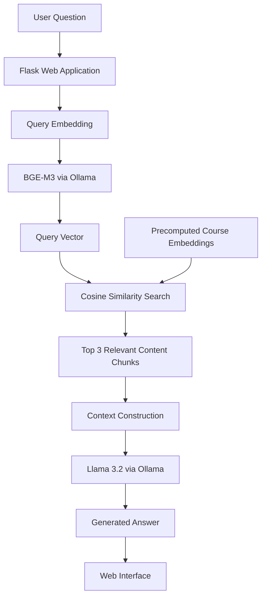

# Cognizant Data & AI RAG Assistant

### An Intelligent Retrieval-Augmented Generation (RAG) System for Course Navigation

An AI-powered course assistant designed to help users search, retrieve, and understand concepts from Cognizant Data & AI learning materials. Built using **Retrieval-Augmented Generation (RAG)**, semantic embeddings, vector similarity search, and Large Language Models (LLMs).

The system allows users to ask natural-language questions and receive context-aware answers based on relevant course content, making learning resources easier to explore and navigate.

---

## Overview

Finding a specific concept, explanation, or topic across hours of educational video content can be time-consuming.

This project addresses that challenge by building an intelligent question-answering system that retrieves relevant information from a collection of course transcripts and uses an LLM to generate contextual responses.

Instead of relying entirely on the model's pre-trained knowledge, the assistant retrieves relevant information from the available learning material before generating an answer.

**The objective:** Transform unstructured educational content into an interactive, searchable knowledge assistant.

## Key Features

- **Natural Language Question Answering:** Ask questions conversationally instead of manually searching through course materials.
- **Semantic Search:** Uses BGE-M3 embeddings to represent text as numerical vectors.
- **Similarity-Based Retrieval:** Uses cosine similarity to identify the most relevant content chunks.
- **Context-Aware AI Responses:** Uses retrieved course content to ground LLM-generated answers.
- **Local LLM Integration:** Runs Llama 3.2 through Ollama for response generation.
- **Flask Backend:** Connects the AI processing pipeline with the web interface.
- **Interactive Web Interface:** Provides a dedicated interface for submitting questions and viewing responses.
- **Course Navigation:** Helps users locate relevant topics and associated video references or timestamps when available in the retrieved content.

## System Architecture

The application follows a Retrieval-Augmented Generation workflow.



### How It Works

1. **Content Preparation:** Course transcripts are processed into structured text chunks.
2. **Embedding Generation:** BGE-M3 converts the text chunks into semantic vector representations.
3. **Query Processing:** The user's question is converted into an embedding using Ollama.
4. **Semantic Retrieval:** Cosine similarity compares the query embedding against the precomputed course embeddings.
5. **Context Selection:** The three most relevant chunks are selected as context.
6. **Response Generation:** The retrieved context is passed to Llama 3.2 to generate a relevant response.
7. **Answer Delivery:** Flask returns the generated answer to the frontend.

## Technology Stack

| Category | Technologies |
|---|---|
| Programming Language | Python |
| Backend | Flask |
| Frontend | HTML, CSS, JavaScript |
| Embedding Model | BGE-M3 |
| Large Language Model | Llama 3.2 |
| Model Runtime | Ollama |
| Retrieval Technique | Cosine Similarity |
| Machine Learning Libraries | Scikit-learn |
| Data Processing | Pandas, NumPy |
| Serialization | Joblib |

## Project Structure

```text
RAG_Project/
│
├── app.py
├── process_incoming.py
├── preprocessed_jsons.py
├── merge_chunks.py
├── mp3_to_json.py
├── video_to_mp3.py
├── sts.py
│
├── templates/
│   └── index.html
│
├── static/
│   ├── css/
│   │   └── style.css
│   └── js/
│       └── script.js
│
├── .gitignore
├── README.md
└── requirements.txt
```

*Generated embeddings, local model files, media files, and course datasets are intentionally excluded from version control.*

## Getting Started

### Prerequisites

Make sure you have the following installed:

- Python 3.10 or later
- Git
- Ollama
- BGE-M3 embedding model
- Llama 3.2 language model

### 1. Clone the Repository

```bash
git clone https://github.com/YazdanAhmedData/Yazdan-s-Cognizant-Data-AI-RAG-Assistant.git

cd Yazdan-s-Cognizant-Data-AI-RAG-Assistant
```

### 2. Create a Virtual Environment

```bash
python3 -m venv .venv
```

Activate it:

**macOS / Linux**

```bash
source .venv/bin/activate
```

**Windows**

```bash
.venv\Scripts\activate
```

### 3. Install Dependencies

```bash
pip install -r requirements.txt
```

### 4. Set Up Ollama

Install Ollama from:

https://ollama.com/

Download the required models:

```bash
ollama pull bge-m3
ollama pull llama3.2
```

Ensure the Ollama service is running before starting the application.

### 5. Prepare the Knowledge Base

The application requires a processed course dataset and precomputed embeddings.

Place your authorized course data and generated embedding artifact in the locations expected by the processing scripts.

**Note:** Course datasets and generated embedding files are not included in this repository. You must prepare your own authorized data before running the complete RAG pipeline.

### 6. Launch the Application

```bash
python app.py
```

Open your browser and navigate to:

```text
http://127.0.0.1:5000
```

## Engineering Concepts Demonstrated

This project demonstrates practical implementation of several AI and software engineering concepts:

- Retrieval-Augmented Generation (RAG)
- Semantic Text Embeddings
- Vector Similarity Search
- Cosine Similarity
- Context Retrieval and Prompt Engineering
- Local Large Language Model Integration
- Backend API Development using Flask
- Frontend and Backend Integration
- Data Preprocessing and Text Chunking
- AI Application Development using Python

## Future Enhancements

The project can be extended with:

- Persistent vector databases such as FAISS or ChromaDB.
- Metadata filtering for improved retrieval accuracy.
- Hybrid search combining semantic and keyword retrieval.
- Source citations with precise video timestamps.
- Conversation memory and multi-turn question answering.
- Streaming responses for a more responsive user experience.
- Evaluation metrics for retrieval quality and answer accuracy.
- Cloud deployment with a scalable backend architecture.

## Project Information

**Project:** Cognizant Data & AI RAG Assistant  
**Domain:** Artificial Intelligence | Machine Learning | Generative AI  
**Architecture:** Retrieval-Augmented Generation  
**Development:** Python, Flask, Ollama and JavaScript

**Developed by:** Yazdan Ahmed

- GitHub: [YazdanAhmedData](https://github.com/YazdanAhmedData)
- Repository: [Cognizant Data & AI RAG Assistant](https://github.com/YazdanAhmedData/Yazdan-s-Cognizant-Data-AI-RAG-Assistant)

---

*This is an independent educational project. It is not an official Cognizant product or service.*
